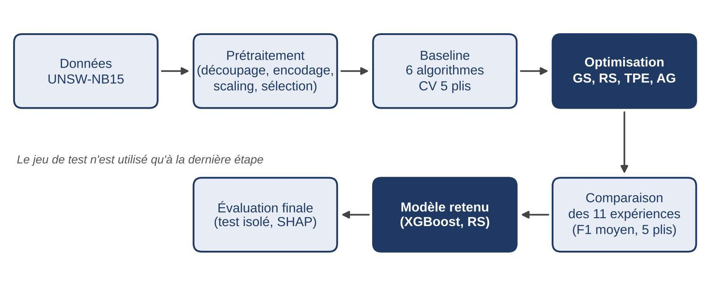
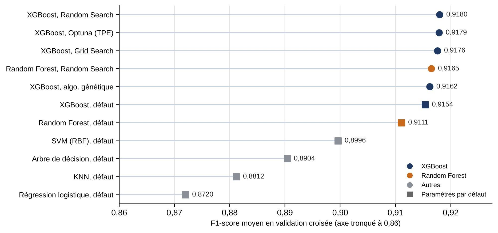
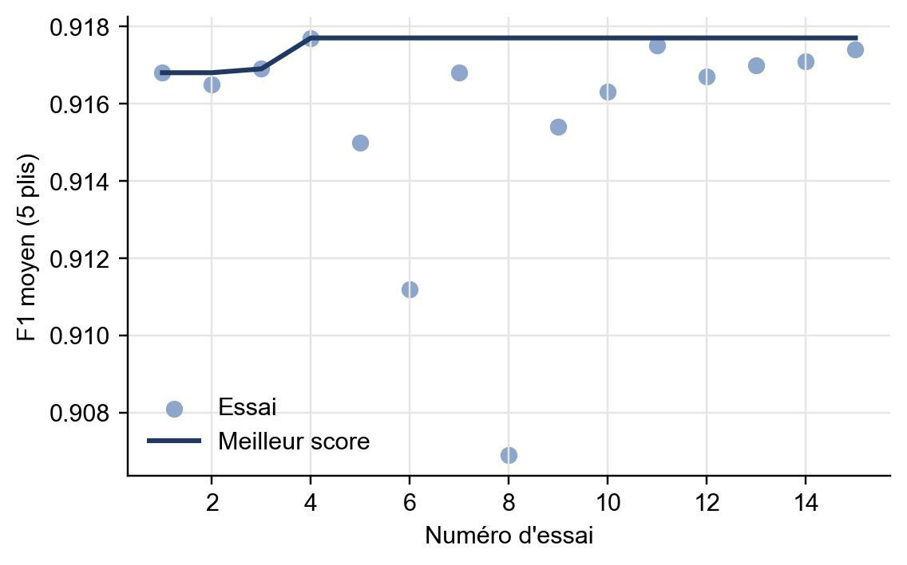
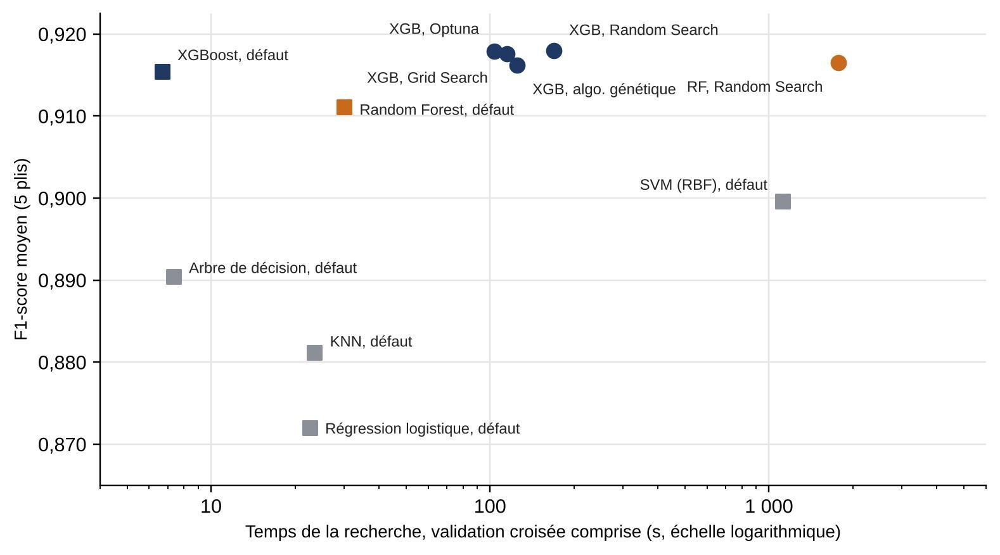
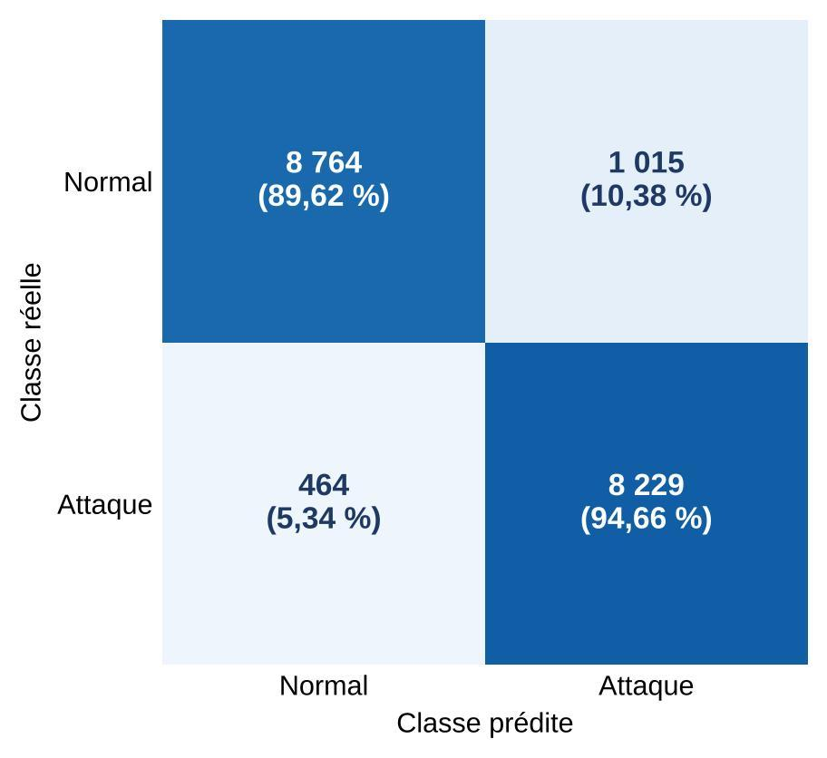
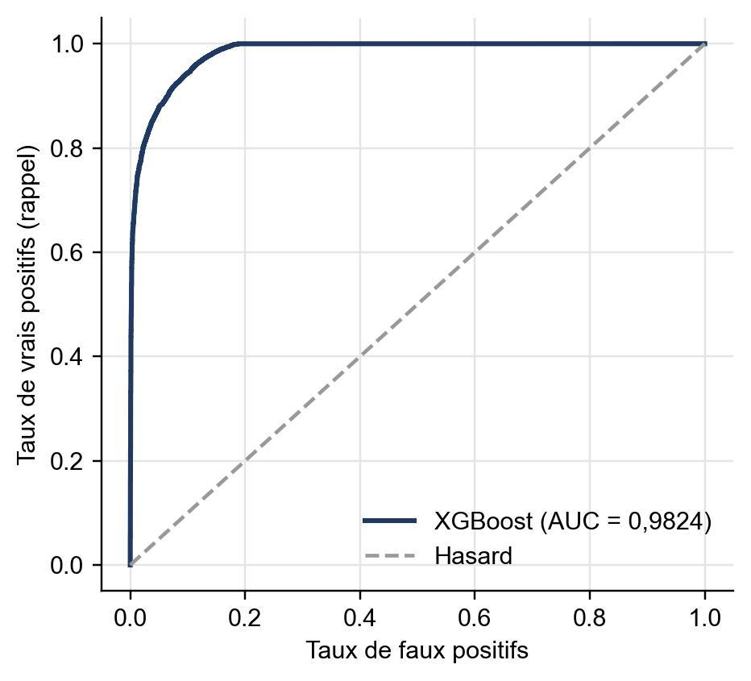
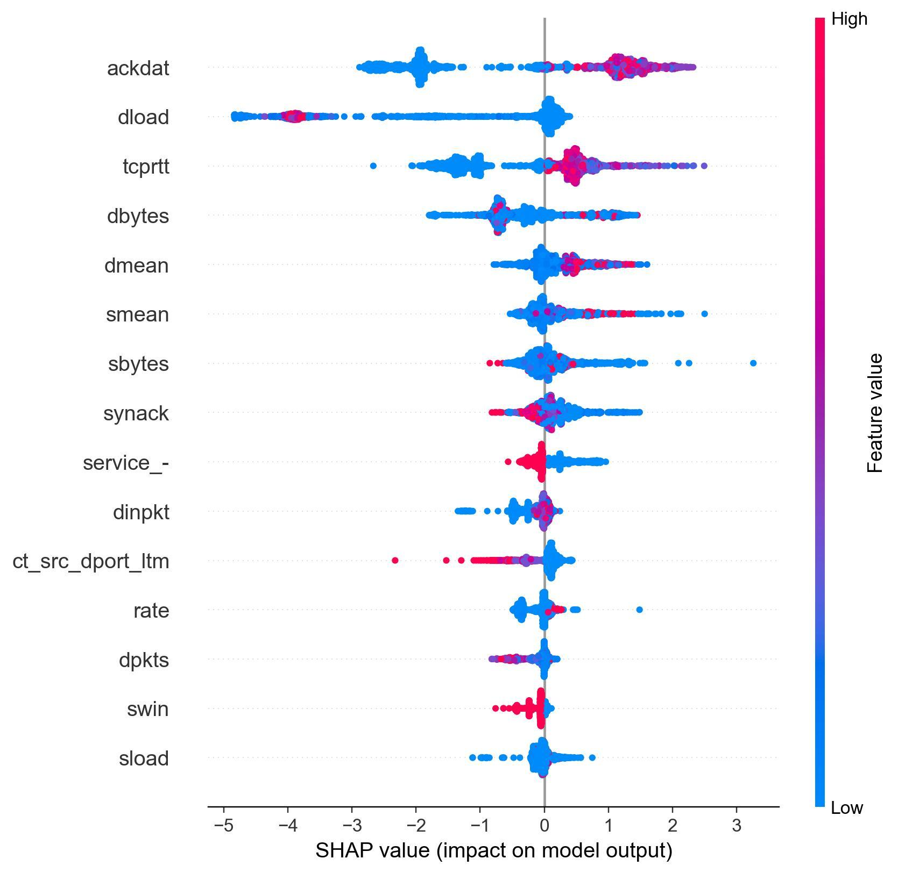

# Détection d'intrusions réseau (NIDS) et optimisation d'hyperparamètres sur UNSW-NB15

Ce dépôt contient le code source, les données prétraitées, les notebooks d'expérimentation et le rapport technique du projet de Data Mining portant sur la comparaison systématique de méthodes d'optimisation d'hyperparamètres appliquées à la détection d'intrusions réseau (NIDS) en classification binaire (trafic normal ou attaque) sur le jeu de données **UNSW-NB15**.

## Résumé du projet

L'objectif est d'évaluer l'apport et le coût computationnel de différentes stratégies de recherche d'hyperparamètres pour des modèles d'apprentissage automatique appliqués à des données de flux réseau, selon un protocole strict sans fuite d'information (*zero data leakage*).

Le fichier de départ de l'étude est `UNSW_NB15_training-set.parquet` (175 341 flux réseau bruts). Le benchmark complet UNSW-NB15 distribué par l'ACCS comprend environ 257 673 flux, répartis entre ce fichier et une seconde partition de 82 332 flux (`UNSW_NB15_testing-set.parquet`). Après suppression de l'identifiant technique `id`, de la cible textuelle `attack_cat` et des 82 984 enregistrements dupliqués, nous obtenons 92 357 flux uniques (environ 52,9 % de trafic normal et 47,1 % d'attaques). Les données sont découpées en 80 % d'entraînement (73 885 flux) et 20 % de test (18 472 flux) avec stratification (`random_state=42`).

L'encodage One-Hot des variables catégorielles (`proto`, `service`, `state`), la standardisation et la sélection de variables (élimination des corrélations supérieures à 0,95 et élagage par importance Random Forest inférieure à 0,0001) sont ajustés exclusivement sur le jeu d'entraînement, réduisant l'espace de 186 à 46 caractéristiques.

Six algorithmes de familles distinctes sont évalués avec leurs hyperparamètres par défaut par validation croisée stratifiée à 5 plis. Les deux meilleurs (XGBoost et Random Forest) sont ensuite optimisés à l'aide de quatre méthodes : Grid Search, Random Search, optimisation bayésienne (Optuna / TPE) et algorithme génétique (DEAP). Le modèle champion retenu est réentraîné sur l'ensemble d'entraînement puis évalué une seule fois sur le jeu de test isolé, complété par une analyse d'interprétabilité avec SHAP (*TreeExplainer*).



---

## Résultats expérimentaux

### 1. Comparaison en validation croisée stratifiée à 5 plis (73 885 flux)

Le tableau suivant récapitule les onze expériences conduites dans le cadre de l'étude, classées par F1-score moyen décroissant :

| N° | Modèle | Méthode d'optimisation | Hyperparamètres retenus | Accuracy | Précision | Rappel | F1-score | Temps (s) |
|:---:|:---|:---|:---|:---:|:---:|:---:|:---:|:---:|
| 1 | XGBoost | Random Search | `n_estimators=150, max_depth=7, lr=0.1, subsample=1.0, colsample=0.9, min_child_weight=1` | 0,9205 | 0,8920 | 0,9455 | 0,9180 | 168,99 |
| 2 | XGBoost | Optuna (TPE) | `n_estimators=191, max_depth=9, lr=0.0414, subsample=0.854, colsample=0.878` | 0,9202 | 0,8896 | 0,9480 | 0,9179 | 103,80 |
| 3 | XGBoost | Grid Search | `n_estimators=200, max_depth=8, lr=0.05` | 0,9199 | 0,8895 | 0,9475 | 0,9176 | 115,26 |
| 4 | Random Forest | Random Search | `n_estimators=150, min_samples_split=5, min_samples_leaf=4, max_features=0.5, max_depth=None` | 0,9194 | 0,8943 | 0,9399 | 0,9165 | 1 772,49 |
| 5 | XGBoost | Algorithme génétique (DEAP) | `n_estimators=239, max_depth=5, lr=0.1009, subsample=0.7` | 0,9187 | 0,8899 | 0,9441 | 0,9162 | 124,95 |
| 6 | XGBoost | Baseline (défaut) | `n_estimators=100, max_depth=6` | 0,9185 | 0,8947 | 0,9370 | 0,9154 | 6,67 |
| 7 | Random Forest | Baseline (défaut) | `n_estimators=100` | 0,9142 | 0,8885 | 0,9349 | 0,9111 | 29,98 |
| 8 | SVM (RBF) | Baseline (défaut) | `C=1.0, kernel='rbf'` | 0,8956 | 0,8220 | 0,9934 | 0,8996 | 1 121,75 |
| 9 | Arbre de décision | Baseline (défaut) | `criterion='gini'` | 0,8972 | 0,8933 | 0,8875 | 0,8904 | 7,33 |
| 10 | KNN | Baseline (défaut) | `n_neighbors=5` | 0,8839 | 0,8498 | 0,9151 | 0,8812 | 23,47 |
| 11 | Régression logistique | Baseline (défaut) | `max_iter=1000` | 0,8701 | 0,8126 | 0,9409 | 0,8720 | 22,57 |



#### Analyse des méthodes d'optimisation
- **Random Search et Optuna :** XGBoost optimisé par Random Search obtient 0,9180 et Optuna 0,9179, à égalité pratique avec Grid Search (0,9176). Optuna converge vers son optimum en 103,80 s, soit 38 % de moins que Random Search (168,99 s). Lors de sa phase de recherche séquentielle (Figure 3), le meilleur essai atteint 0,9177 au 4e essai ; sa réévaluation standardisée avec les paramètres retenus sous `cross_validate` donne 0,9179.
- **Random Forest :** Random Search fait progresser le F1 de 0,9111 à 0,9165. Cependant, ses 20 tirages demandent 1 772,49 s (~29,5 minutes), soit 88,6 s par tirage en validation croisée 5 plis, justifiant de ne pas étendre d'autres optimisations plus lourdes sur ce modèle.




---

### 2. Évaluation du modèle champion sur le jeu de test isolé (18 472 flux)

Le modèle retenu (XGBoost optimisé par Random Search / Optuna) a été réentraîné en 1,37 s sur l'ensemble d'entraînement et testé une seule fois sur le jeu de test holdout :

| Métrique | Valeur sur le jeu de test | Valeur en validation croisée |
|:---|:---:|:---:|
| Accuracy | 91,99 % | 92,05 % |
| ROC-AUC | 0,9824 | non calculé |
| Précision (classe Attaque) | 0,8902 | 0,8920 |
| Rappel (classe Attaque) | 0,9466 | 0,9455 |
| F1-score (classe Attaque) | 0,9175 | 0,9180 |
| Macro : précision / rappel / F1 | 0,9200 / 0,9214 / 0,9199 | non calculé |
| Pondérée : précision / rappel / F1 | 0,9217 / 0,9199 / 0,9200 | non calculé |
| Taux de faux positifs (FPR) | 10,38 % | non calculé |
| Taux de faux négatifs (FNR) | 5,34 % | non calculé |
| Latence de prédiction par flux | 2,28 à 2,63 µs | non calculé |

**Matrice de confusion et courbe ROC :**
- Flux normaux : 8 764 bien classés (vrais négatifs) et 1 015 fausses alertes (faux positifs), soit un taux de faux positifs de 10,38 %.
- Attaques : 8 229 détectées (vrais positifs) et 464 non détectées (faux négatifs), soit un taux de faux négatifs de 5,34 % (rappel de 94,66 %).




---

## Interprétabilité SHAP

L'analyse d'interprétabilité par valeurs SHAP (*TreeExplainer*) met en évidence les contributions suivantes :
- `state_INT` arrive en tête selon l'importance par gain interne de XGBoost (connexions interrompues, typiques de scans de ports).
- Le diagramme SHAP place `ackdat`, `dload` et `tcprtt` aux trois premières positions selon l'impact moyen absolu :
  - `ackdat` et `tcprtt` : des valeurs élevées (poignée de main TCP anormalement lente) sont associées à des valeurs SHAP positives, poussant la prédiction vers la classe Attaque.
  - `dload` : des valeurs élevées ont un impact SHAP fortement négatif (autour de -4), orientant nettement la décision vers le trafic normal.
  - Des tailles moyennes de paquets élevées (`dmean`, `smean`) contribuent vers la classe Attaque, tandis que des valeurs élevées de `service_-`, `ct_src_dport_ltm` et `swin` orientent vers le trafic normal.



---

## Structure du dépôt

```text
network-intrusion-detection-optuna/
├── data/
│   ├── UNSW_NB15_training-set.parquet       # Jeu d'entraînement brut (175 341 flux)
│   ├── UNSW_NB15_testing-set.parquet        # Seconde partition brute (82 332 flux)
│   └── UNSW_NB15_train_clean.parquet        # Données nettoyées sans doublons (92 357 flux)
├── figures/                                 # Figures générées au cours de l'étude (PNG)
│   ├── figure1_pipeline.png
│   ├── figure2_f1_scores.png
│   ├── figure3_optuna_progression.png
│   ├── figure4_search_time_vs_f1.png
│   ├── figure5_confusion_matrix.png
│   ├── figure6_roc_curve.png
│   └── figure7_shap_summary.png
├── models/
│   └── ids_xgboost_champion.joblib          # Modèle champion, transformateurs et colonnes
├── notebooks/
│   ├── 01_eda_and_cleaning.ipynb            # Exploration, audit d'intégrité et nettoyage
│   └── 02_preprocessing_and_baselines.ipynb # Prétraitement, 11 expériences, test et SHAP
├── report/
│   ├── Rapport_DataMining_NIDS.pdf          # Rapport de projet officiel (15 pages)
│   └── RAPPORT_TECHNIQUE.md                 # Version Markdown intégrale du rapport
├── predict.py                               # Script d'inférence en ligne de commande
├── requirements.txt                         # Dépendances Python
├── .gitignore
├── LICENSE
└── README.md
```

---

## Installation et reproduction

### 1. Environnement Python
Il est recommandé d'utiliser un environnement virtuel Python (version 3.10 ou supérieure) :

```bash
python -m venv .venv
# Sous Linux / macOS :
source .venv/bin/activate
# Sous Windows (PowerShell) :
.venv\Scripts\Activate.ps1

pip install -r requirements.txt
```

### 2. Exécution des notebooks
Lancer Jupyter Lab ou Jupyter Notebook :
```bash
jupyter lab
```
1. Exécuter `notebooks/01_eda_and_cleaning.ipynb` pour reproduire l'analyse exploratoire et la génération des données nettoyées.
2. Exécuter `notebooks/02_preprocessing_and_baselines.ipynb` pour reproduire la chaîne complète : prétraitement sans fuite, baselines, optimisations d'hyperparamètres, évaluation sur le jeu de test et analyse SHAP.

### 3. Utilisation du script d'inférence
Le script `predict.py` permet d'appliquer directement le pipeline entraîné et sauvegardé :

```bash
# Démonstration sur un échantillon du jeu de test
python predict.py

# Inférence sur un fichier Parquet ou CSV externe
python predict.py --file data/UNSW_NB15_testing-set.parquet
```

---

## Auteurs et affiliation

- **GHOUL Sami**
- **BELGHACHE Walid**

4e année d'ingéniorat d'État en Informatique, spécialité Génie Logiciel  
Faculté des Sciences Exactes, Département d'Informatique  
Université de Béjaïa — Novembre 2026
